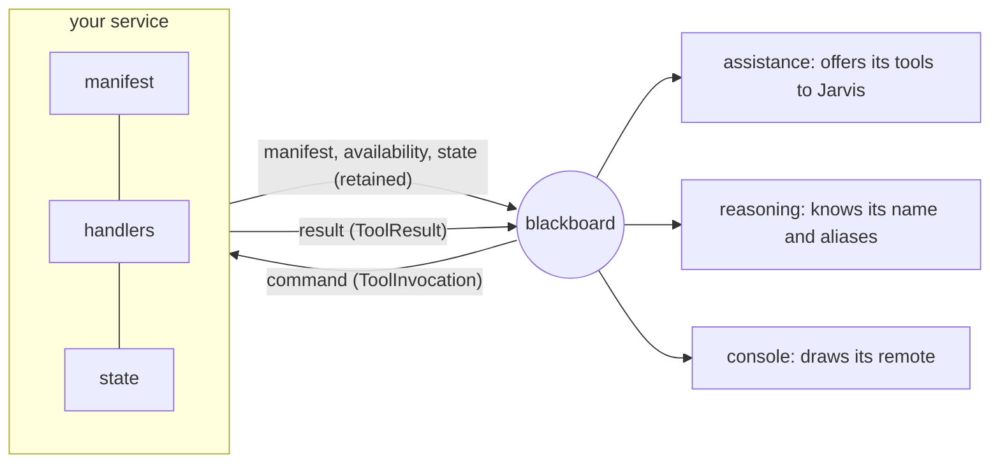

# How to add a service

A fan, a speaker, a lamp behind an MCP server and an ESP32 on the wall are all
the same thing to this system: **a service on the blackboard**. To add one, you
write that service. You don't change the assistant, the executor, the console
or the control loop. They find the new device by its announcement, offer its
actions to Jarvis, and draw a remote for it.

This guide shows how. The design behind it is in
[DESIGN.md §5.11](DESIGN.md#511-device-services-v116-fr-87-to-fr-91), and a
summary is in §5.12.

---

## 1. What a service is

A service is three things:

| Part | What it is | Where it goes |
|---|---|---|
| **Manifest** | What the device is, what people call it, where it is, and what it can do: one *capability* per action, each with its parameters and bounds | `space/device/<id>/manifest`, retained |
| **Handlers** | One function per capability, which does it and says what happened in a sentence | answer `space/device/<id>/command` on `space/device/<id>/result` |
| **State** | Its current values: `on`, `speed`, `volume`, … | `space/device/<id>/state`, retained |

It also says it is **online** on `space/device/<id>/availability`, which is
retained. The broker publishes `offline` for it, as its last will, if it dies.



**What happens when it starts:**
- The assistance service declares each capability as a tool named
  `<device_id>_<capability>`, such as `fan_set_speed`.
- Jarvis can name the device by any of its aliases.
- The console shows a remote for it.

**When it stops, or its link drops,** the tools are withdrawn within a second.
None of this needs a line of code outside the service.

## 2. Choose a route

| Route | Use it when | Example |
|---|---|---|
| **Native Python service** | You write the device's logic here: a simulated device, or one driven by a Python library. It can change state on its own (a song ending, a robot moving) and can follow other topics. | `src/devices/fan` (the smallest), `src/devices/music` |
| **MCP server, through the bridge** | Something already speaks MCP, or you'd rather write a stand-alone MCP server. It answers when asked. Its state is whatever it last answered. | `examples/mcp_lamp/server.py` |
| **No Python at all** | A microcontroller (ESPHome, Tasmota) can publish JSON to MQTT itself. | the topics in §5 below |

The routes are interchangeable. Jarvis, the executor and the console cannot
tell which one a device took.

## 3. A native service, step by step

We'll write a kettle. A complete device is about thirty lines; compare
`src/devices/fan/__init__.py`.

### 3.1 The manifest

```python
from src.common.devices import DeviceCapability, DeviceClass, DeviceKind, DeviceManifest
from src.common.tools import ParameterType, ToolEffect, ToolParameter

def manifest(config, now: float) -> DeviceManifest:
    return DeviceManifest(
        ts=now,
        device_id="kettle",                    # lower case, unique on the board
        name="Kettle",                         # what Jarvis calls it
        kind=DeviceKind.OTHER,                 # fan, light, media, ac, other: how the console draws it
        room="kitchen",                        # where it is
        aliases=("the kettle",),               # other words people use for it
        simulated=True,                        # required: does it act on anything real? (FR-15)
        capabilities=(
            DeviceCapability(
                name="boil",
                purpose="Boil the kettle.",    # the model reads this to decide when to use it
                effect=ToolEffect.WRITE,       # read, write or commit (commit waits for a yes)
                device_class=DeviceClass.COMFORT,  # comfort or media; plant is never a tool
                min_interval_s=30.0,           # no more often than this
            ),
            DeviceCapability(
                name="set_temperature",
                purpose="Heat the water to a temperature, for tea.",
                effect=ToolEffect.WRITE,
                device_class=DeviceClass.COMFORT,
                parameters=(
                    ToolParameter(name="celsius", type=ParameterType.INTEGER,
                                  description="Water temperature in C", minimum=60, maximum=100),
                ),
            ),
            DeviceCapability(name="status", purpose="Say whether the kettle is on.",
                             effect=ToolEffect.READ, device_class=DeviceClass.COMFORT),
        ),
    )
```

**Choosing the fields:**
- **`effect`** says whose it is to undo:
  - `read` changes nothing;
  - `write` acts at once;
  - `commit` (a booking, a payment) waits for the occupant's spoken or tapped yes (FR-54).
- **`device_class`** says what it can do to the room:
  - `comfort` is physical but outside the thermal model: a fan, a light, a kettle;
  - `media` is sound or a screen;
  - `plant` changes the room's temperature. It is refused as a tool by construction. The AC is reached only through the validator (FR-88).
- **Bounds** (`minimum`, `maximum`) are what stop "set the fan to 9". They are checked by the executor *and* again by the device service.
- **`purpose`** is read by a 7B model. Write it as a short, plain instruction.

### 3.2 The handlers

Each handler takes the checked arguments and returns a `ProviderOutcome`: a
sentence for the person, and the values that changed.

```python
from src.common.tools import ProviderOutcome

class SimulatedKettle:
    def __init__(self) -> None:
        self.on, self.celsius = False, 100

    def boil(self, _arguments) -> ProviderOutcome:
        self.on = True
        return ProviderOutcome(message=f"The kettle is on, heating to {self.celsius} C (simulated).", detail=self.state())

    def set_temperature(self, arguments) -> ProviderOutcome:
        self.celsius = int(arguments["celsius"])
        return ProviderOutcome(message=f"The kettle will heat to {self.celsius} C.", detail=self.state())

    def status(self, _arguments) -> ProviderOutcome:
        return ProviderOutcome(message=f"The kettle is {'on' if self.on else 'off'}.", detail=self.state())

    def state(self) -> dict:
        return {"on": self.on, "celsius": self.celsius}
```

**Rules for handlers:**
- **The message is what Jarvis says.** Write it as a person would, and say "(simulated)" when nothing real happened (FR-15).
- **Refuse in words, not exceptions.** To refuse something ("the kettle is empty"), raise `ToolArgumentError("the kettle is empty")`. The person hears the reason, and the device stays as it was. Any other exception is reported as "Something went wrong with the device; nothing was changed."
- **Answer at once.** A command times out after `actuators.command_timeout_s`, which is 12 s. Something that takes longer (a robot's walk, a kettle boiling) should answer "On my way…" and let its **state** show the progress.

### 3.3 Things that change on their own: `tick`

If the device's state changes without being asked (the water boils, a song
ends, a robot reaches the kitchen), give it a `tick`. The runner calls it about
once a second. Read time from the injected `Clock`, never `time.time()`.

```python
def tick(service) -> None:
    if kettle.on and clock.now() - kettle.started >= BOIL_S:
        kettle.on = False
        service.publish_state()     # tell the board straight away
```

### 3.4 Following other topics: `subscribe`

A service can also listen to the board. Music follows the speech status, so it
can dip while Jarvis talks. `subscribe(blackboard)` is called once, before the
service connects. Subscribe only to topics declared in `src/common/topics.py`,
with their schemas from `src/common/schemas.py`. Never write a topic string
yourself.

### 3.5 Putting it together

```python
# src/devices/kettle/__init__.py
from src.devices.runner import DeviceParts

def build(config, clock) -> DeviceParts:
    kettle = SimulatedKettle()
    handlers = {"boil": kettle.boil, "set_temperature": kettle.set_temperature, "status": kettle.status}
    return DeviceParts(manifest=manifest(config, clock.now()), handlers=handlers, state=kettle.state)
```

```python
# src/devices/kettle/__main__.py
from src.devices.kettle import build
from src.devices.runner import run

def main(argv=None) -> int:
    return run(argv, "Run the kettle.", "device-kettle", build)

if __name__ == "__main__":
    raise SystemExit(main())
```

**What the runner does for you:**
- connects to the broker, with the last will;
- announces the device, and announces it again after every reconnect;
- checks every command against the manifest: unknown capability, bounds and rate limit;
- publishes results and state, and calls `tick`.

**Every capability needs a handler, and every handler a capability.** The
service refuses to start otherwise.

`build` may return **a list** of `DeviceParts`, which puts several devices in
one process, each on its own connection. That is how one service can run every
light in the house.

### 3.6 Configuration

Every number a person might tune goes into config, not code. Add a section to
`ActuatorsConfig` in `src/common/config.py`, following `FanConfig`. Give each
field a default, a unit in its description and its bounds. Then add it to
`config/default.yaml` with a comment saying why the default is what it is.
Include an `enabled` switch, so the device can be turned off without removing
it.

### 3.7 Running it with the rest of the system

Add a `Service` entry to `SERVICES` in `start.py`:

```python
Service(name="kettle", module="src.devices.kettle", description="The kitchen kettle, a device service (FR-xx)"),
```

`python start.py` now starts it, restarts it if it dies, and stops it with
everything else. `python -m src.devices.kettle` runs it alone.

## 4. An MCP server

Any MCP server becomes a device by adding it to `actuators.mcp_servers`. The
bridge (`src/devices/mcp_bridge`) starts it over stdio, lists its tools and
mounts it.

```yaml
actuators:
  mcp_servers:
    - device_id: kettle
      name: Kettle
      kind: other
      aliases: [the kettle]
      simulated: true
      command: python
      args: [examples/kettle_mcp/server.py]
      tools:                                  # only these are exposed
        boil: {effect: write, device_class: comfort}
        get_status: {effect: read, device_class: comfort}
```

**What the bridge enforces:**
- **Only the tools you list are exposed.** A server's `factory_reset` stays hidden unless you name it.
- **The effect and safety class come from this file, not from the server.** A server's own annotations describe itself, and the confirmation gate must not rest on them. `plant` is refused.
- **The tool's JSON schema becomes checked parameters.** A nested object is refused at startup rather than passed through unchecked.

The result becomes a sentence, and its flat fields become the device's state.
An MCP server knows its state only when asked: the console reads it quietly
when its remote is opened. If you need state that moves on its own, write a
native service.

## 5. Without Python

A node that can publish MQTT JSON can be a device itself:

| Topic | Retained | Payload |
|---|---|---|
| `space/device/<id>/manifest` | yes | the manifest, as in §3.1 |
| `space/device/<id>/availability` | yes | `{"ts": …, "device_id": "<id>", "online": true}`; set the same with `false` as the MQTT last will |
| `space/device/<id>/command` | subscribe | a `ToolInvocation`: `tool` is the capability, `arguments` its values |
| `space/device/<id>/result` | no | a `ToolResult` carrying the command's `invocation_id`, a `status` and a `message` |
| `space/device/<id>/state` | yes | `{"ts": …, "device_id": "<id>", "values": {…}, "simulated": true}`, with flat values only |

The console's topic guide (**Topics**) shows every field of every payload.

## 6. Using another device

A service sometimes needs another device; a robot that switches on the TV is
one example. **It never calls that device or publishes on that device's command
topic.** It asks the same way a remote does: a `ToolInvocation` for
`<device>_<capability>` on `space/assist/proposed`.

The executor then applies the same checks it applies to Jarvis and to a
person's tap:
- the argument bounds;
- the rate limit;
- the confirmation gate for `commit`;
- the refusal of `plant`.

The call is audited like any other, and the answer comes back on
`space/assist/result` with the same `invocation_id`.

This is planned with the robot (FR-100). It will add a requester of its own,
so the audit names the device that asked. No device does this yet.

## 7. Safety, in one place

| Rule | Enforced by |
|---|---|
| `plant` capabilities are never tools; the room's temperature goes through the validator | the manifest's check, the directory, the device service and the bridge (FR-88) |
| Arguments stay within their declared bounds | the executor's registry **and** the device service |
| A capability runs no more often than its `min_interval_s` | the device service |
| `commit` waits for the occupant's yes | the executor's confirmation gate (FR-54) |
| Nothing claims to be real when it isn't | `simulated` in the manifest, required, and "(simulated)" in the reply (FR-15) |
| A device that dies is withdrawn | the last will, published by the broker |

## 8. A remote of its own

Every device gets a remote on the console's **Remotes** page with no work at
all. The generic remote is drawn from the manifest: a button per action, and a
slider per bounded number.

To give a kind of device a remote of its own, add one file to
`console/web/src/remotes/` and one line to `registry.ts`. The rule is first
match wins: a remote for the device's id, then one for its kind, then the
generic remote. A remote's `call` goes through the executor, never to the
device. The [README](../README.md#remotes-controlling-devices-by-hand) has a
worked example. Rebuild with `npm run build` in `console/web`.

## 9. Tests, and when it's done

Test the service with `SimClock` and `LoopbackTransport`, so tests need no
broker and no waiting. `tests/devices/test_fan.py` is the pattern:

```python
clock = SimClock(start_epoch_s=1000.0)
parts = build(CONFIG, clock)
service = DeviceService(parts.manifest, parts.handlers, parts.state, clock, Blackboard(CONFIG.mqtt, LoopbackTransport()))
result = service.handle(ToolInvocation(ts=clock.now(), invocation_id="i1", tool="boil", arguments={},
                                       requester=ToolRequester.CONSOLE, expires_ts=clock.now() + 60))
```

**The service is done when all of these hold:**
- [ ] **The manifest's tests pass:** simulated or not, no `plant`, reads marked `read`, bounds present.
- [ ] **Each handler is tested** with its edge cases: already on, at the bounds, refused.
- [ ] **A `tick` is tested by advancing the `SimClock`,** never by sleeping.
- [ ] **No direct clock calls.** No topic literals outside `topics.py`. Imports only from `src.common` and `src/devices`.
- [ ] **Every tunable is in config** with a default and a unit.
- [ ] **It is registered in `start.py`,** and listed in the README's device table.
- [ ] **The commit message names its requirement ID,** such as `devices: a kettle (FR-xx)`.
- [ ] **Run with `python start.py`:**
  - it appears on Remotes;
  - Jarvis can use it by name;
  - stopping its service greys it out.
